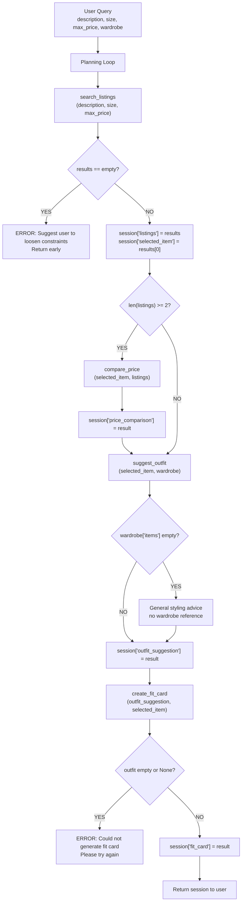

# FitFindr — planning.md

> Complete this document before writing any implementation code.
> Your spec and agent diagram are what you'll use to direct AI tools (Claude, Copilot, etc.) to generate your implementation — the more specific they are, the more useful the generated code will be.
> Your planning.md will be reviewed as part of your submission.
> Update it before starting any stretch features.

---

## Tools

### Tool 1: search_listings

**What it does:**

Searches the mock listings dataset based on the user's description, size, and maximum price, and returns a list of matching items.

**Input parameters:**

- `description` (str): A natural language description of the item the user is looking for
- `size` (str): The desired clothing size
- `max_price` (float): The maximum price

**What it returns:**

A list of matching item dicts. Each dict contains:
id(str), title(str), description(str), category(str), style_tags(list of str), size(str), condition(str), price(float), colors(list of str), brand(str), platform(str)

**What happens if it fails or returns nothing:**

If the result is an empty list, the agent does not call any further tools. It suggest the user to loosen constraints.

---

### Tool 2: suggest_outfit

**What it does:**

Given a specific item and the user's current wardrobe, suggests one or more complete outfit combinations by reasoning about how the new item pairs with existing wardrobe pieces.

**Input parameters:**

- `new_item` (dict): The item selected from search_listings results. Contains fields such as title, description, style_tags, colors, and category.
- `wardrobe` (dict): The user's existing wardrobe. Contains an items key with a list of clothing item dicts, each with fields such as title, category, colors, and style_tags.

**What it returns:**

A string containing one or more outfit suggestions, describing which wardrobe pieces to pair with the new item and how to style them.

**What happens if it fails or returns nothing:**

If wardrobe['items'] is empty, the agent does not crash. Instead, it returns general styling advice for the new item without referencing any specific wardrobe pieces.

---

### Tool 3: create_fit_card

**What it does:**

Generates a short, shareable outfit caption based on the outfit suggestion and the newly found item.

**Input parameters:**

- `outfit` (str): The outfit suggestion string returned by suggest_outfit.
- `new_item` (dict): The item selected from search_listings. Contains fields such as title, price, colors, and style_tags.

**What it returns:**

A short, casual, social-media-style caption string describing the outfit and the thrifted find. Output shoud vary each time even for the same input.

**What happens if it fails or returns nothing:**

If outfit is an empty string or None, the agent does not call the LLM. It returns an error message.

---

### Additional Tools (if any)

### Tool 4: compare_price
**What it does:**

Given a selected item and full search results, estimates whether its price is fair by comparing it against other listings returned by search_listings based on category, style tags, and condition.

**Input parameters:**

- `item` (dict): The item to evaluate. Contains fields such as title, category, style_tags, condition, and price.
- `listings` (list of dict): The full list of results returned by search_listings, used as comparable items for price comparison.

**What it returns:**

A string containing a price assessment with reasoning.

**What happens if it fails or returns nothing:**

If listings contains fewer than 2 items, the agent does not call compare_price at all. Price comparison is skipped silently and the agent proceeds to the next step.

---

## Planning Loop

**How does your agent decide which tool to call next?**

The planning loop checks result of each tool call before deciding what to do next.

1. Call search_listings(description, size, max_price).
     - If result is an empty list --> return. Do not call any futher tools.
     - If result is a non-empty list --> store as session["listings"], set session["selected_item"] = results[0], proceed to step2. 
2. If len(session["listings"]) >= 2 --> call compare_price(session["selected_item"], session["listings"]), store result as session["price_comparison"].
     - If len(session["listings"]) < 2 --> skip compare_price and proceed to step3.
3. Call suggest_outfit(session["selected_item"], wardrobe).
     - Store result as session["outfit_suggestion"], proceed to step4.
4. Call create_fit_card(session["outfit_suggestion"], session["selected_item"]).
     - Store result as session["fit_card"].
     - Return full session to the user.

---

## State Management

**How does information from one tool get passed to the next?**

The agent maintains a session dictionary throughout a single interaction.
Values are stored after each tool call and passed directly into the next tool without requiring user re-entry.
- `session["listings"]`: full list of results from search_listings
- `session["selected_item"]`: first item from session["listings"], passed into compare_price and suggest_outfit
- `session["price_comparison"]`: string result from compare_price
- `session["outfit_suggestion"]`: string result from suggest_outfit, passed into create_fit_card
- `session["fit_card"]`: final caption string from create_fit_card
- `session["error"]`: error message string, set if any tool fails or returns nothing

---

## Error Handling

| Tool | Failure mode | Agent response |
|------|-------------|----------------|
| search_listings | No results match the query |Does not call any futher tools. Suggests the user to loosen constraints. |
| suggest_outfit | Wardrobe is empty | Returns general styling advice for the new item without referencing any specific wardrobe pieces.|
| create_fit_card | Outfit input is missing or incomplete | Does not call the LLM. Return the error message.|
| compare_price | Fewer than 2 listings available | Does not call compare_price at all.|

---

## Architecture

---

## AI Tool Plan

**Milestone 3 — Individual tool implementations:**

- search_listings

Give Claude the tool1 spec and ask it to implement the function using load_listings(). 
Verify that the generated code filters by all three parameters and returns an empty list when no results are found. Test with 2 queries: one with results, one with no results.

- suggest_outfit

Give Claude the tool2 spec and ask it to implement the function using Groq's llama-3.3-70b-versatile. Verify that the generated code handles wardrobe["items"] == [] without crashing. Test with example wardrobe and empty wardrobe.

- create_fit_card

Give Claude the tool3 spec and ask it to implement the function using Groq's llama-3.3-70b-versatile. Verify that the generated code returns an error message string when outfit is empty or None. Run 3 times on the same input to confirm output varies.

- compare_price

Give Claude the tool4 spec and ask it to implement the function using only the listings list. Verify that the function is never called when len(listings) < 2.

---

**Milestone 4 — Planning loop and state management:**

Give Claude the full Architecture diagram and the Planning Loop + State Management sections from planning.md. Ask it to implement run_agent() in agent.py. Before running, verify that:

(1) the code branches on the search_listings result,

(2) values are stored in the session dict after each tool call,

(3) tools are not called unconditionally in a fixed sequence. Test with a happy-path query and a no-results query to confirm different behavior.

---

## A Complete Interaction (Step by Step)

**Example user query:** "I'm looking for a vintage graphic tee under $30. I mostly wear baggy jeans and chunky sneakers. What's out there and how would I style it?"

**Step 1:**

The agent calls search_listings(description="vintage graphic tee", size=None, max_price=30.0). The function filters the mock listings dataset and returns a list of matching items. The agent stores the full list as session["listings"] and sets session["selected_item"] = results[0].

**Step 2:**

Since len(session["listings"]) >= 2, the agent calls compare_price(session["selected_item"], session["listings"]). The function compares the selected item's price against similar listings and returns a price assessment string. The result is stored as session["price_comparison"].

**Step 3:**

The agent calls suggest_outfit(session["selected_item"], wardrobe). The wardrobe contains items so the LLM generates a specific outfit suggestion referencing existing wardrobe pieces. The result is stored as session["outfit_suggestion"].

**Step 4:**

The agent calls create_fit_card(session["outfit_suggestion"], session["selected_item"]). The LLM generates a short, casual caption. The result is stored as session["fit_card"].

**Final output to user:**

The user sees four outputs,
- Search result: "Faded Band Tee - $22, Good condition"
- Price comparison: "This item is priced at $22, which is below the average of $31 for similar items - this is a good deal."
- Outfit suggestion: "Pair this with your baggy straight-leg jeans and chunky white sneakers for a classic 90s streetwear look."
- Fit card: "thrifted this faded band tee for $22 and it was literally made for my baggy jeans 🖤 full look dropping soon"
